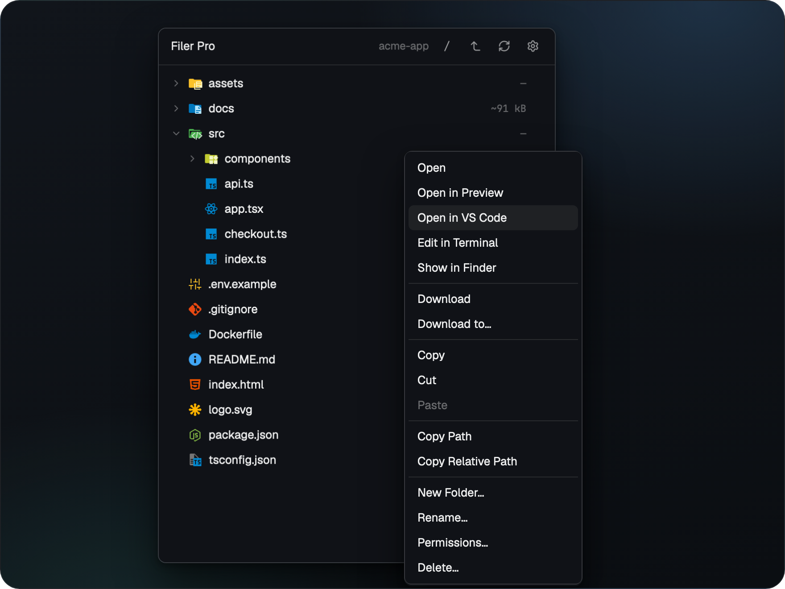
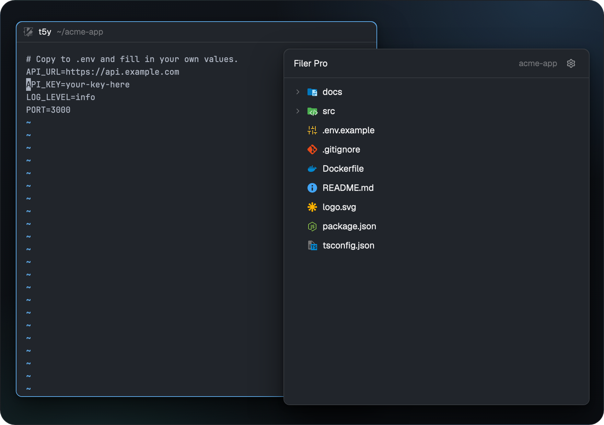
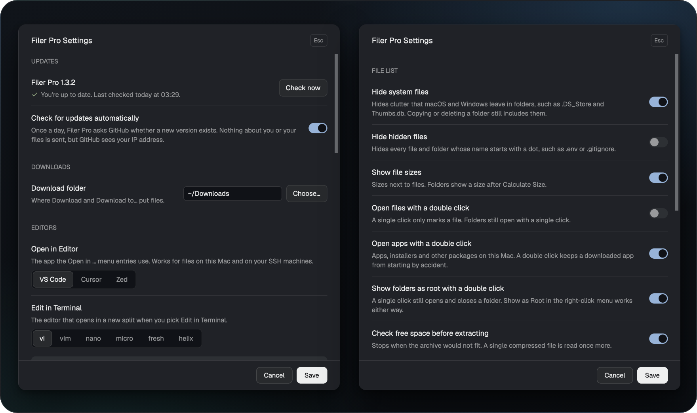

# Filer Pro


**A file panel for the [Herdr app](https://herdr.dev) that works the same on your Mac and on every machine you reach over SSH.**

<br>

<p align="center"><a href="https://www.buymeacoffee.com/michaelmayer"></a></p>

<br>

## Install

In Herdr, ask your agent:

```text
Read ~/.config/herdr-app/AGENTS.md, then add this mod: https://github.com/Srv-02/herdr-filerpro/tree/main
```

Then click `Filer Pro` in the tab bar. To install by hand, see [Manual install](#manual-install).

## Features

### Follows your terminal


The tree shows the folder of the focused terminal, locally or on its machine. Right click for open, edit, calculate size, download, copy, paste, rename, permissions and delete. Apps and other macOS packages show as files: a double click starts them, and Show Package Contents looks inside. System files like `.DS_Store` stay out of the way, and hidden files can go too. A folder you may not read or search shows the row "No permission to list this folder" below it instead of looking empty. Git marks (`M`, `A`, `U`, `D`) are shown for the folder you are looking at, also when it is reached through a symbolic link, and for a folder inside a repository; paths of the repository outside that folder are not shown. When the shown folder is a subfolder of a repository, the repository's `.git` above it is watched as well (locally), so marks follow `git add`, `git commit`, `git reset` and `git restore --staged` within about a second.

With **Show file sizes** on (Settings, File list; off by default) each file shows its size right-aligned next to the name, in decimal units like the Finder (1 kB = 1000 bytes, up to PB). A symbolic link shows the size of the link itself. The sizes come with the listing, from one batched `stat` per folder in the same command, so they follow the same reloads and cost no extra round trip on a machine; off, the listing runs exactly as before. Folders show `—` until you pick **Calculate Size** in their row menu (also for apps and other packages, which show no size before): it adds up all files below, without following links, and the result shows in the size column and at the right of the menu entry until **Refresh** or the next Calculate Size. A folder that takes longer than 120 seconds shows "Too large to calculate". On Windows (this computer) Calculate Size is dimmed.

To look above the terminal's folder without leaving the terminal, use **Up one level** (the bent arrow right of the folder name in the header): each click shows the parent folder. **Go to /** (the slash before it) jumps straight to `/`. The header then shows the path of the shown folder (from `~`, cut at the front when the panel is narrow) and **Back to the terminal's folder** (the highlighted folder tree icon after Up). The tree stays where you navigated, also when you `cd` in the terminal, until you click that button; it then shows the folder the terminal is in now. The navigated folder belongs to the terminal you navigated from: another terminal shows its own folder, and switching back shows the navigated one again. Expanded folders and the open file are kept where they lie inside the new folder. On a machine the new folder is listed with the same commands as before. `/` and the folders above your home folder are not watched for changes (a watch there would wake for every change on the disk): use **Refresh** there.

The tree and the open file stay current without polling. On this computer they follow file system events: when an agent or another editor changes the open file, the view updates in place. Only changes Filer Pro can show trigger a reload (entries of the shown folder and of expanded folders, the open file, the git index, `HEAD` and refs), at most once per second; writes in collapsed folders, caches below a home folder or hidden entries while hidden files are hidden cost nothing. An expanded folder that is a symbolic link to another folder inside the shown folder follows changes too. The target of a link that points outside the shown folder is not watched: a change there shows on **Refresh** or after your next action. On an SSH machine Filer Pro sends no commands while you just look: the tree and the open file reload after your own actions in Filer Pro, when you switch to another terminal or folder, and on **Refresh** (the circular arrows in the header); a file you click is always read fresh. A change made on the machine by something else shows at the next of these. Unsaved edits are never replaced by a reload; saving then checks for the outside change as usual. If you want a timer anyway, set **Look for changes every** (`refresh_seconds`) in Settings; a value already saved in `filer-pro.json` (for example the old default 10) keeps polling until you set it to 0. Hand edits of `filer-pro.json` apply on **Refresh** or after saving Settings.

### Transfers you can trust


Drop files from the Finder to upload, right click to download. Every transfer shows progress and can be cancelled, and nothing is overwritten without asking. Copy on one machine and Paste on another copies between the two machines through this computer (`scp -3`): the data travels over your connection twice, and the two machines need no access to each other. A short warning names both machines and the amount first; **Don't show again** in it, or **Warn before copying between machines** in Settings, turns it off. Cut and Paste between two machines is not possible.

### Preview


Markdown renders with Mermaid diagrams, PDF shows page by page (Previous and Next buttons in the header) and always fits the panel width. In full screen you choose Single page or Two pages (the cover alone) and Page, Width or 100 %, or zoom from 50 to 300 % (buttons, cmd-+ / cmd-- / cmd-0 or + / - / 0, cmd + scroll wheel). Remote content inside documents is never loaded. `←` goes back to the tree where you left it, with the file you just opened marked.

### Source, HTML and images


Code opens with syntax colors and line wrap, HTML and images open in place. One click goes fullscreen.

Files that are not text say why instead of a generic error: "File larger than 1 MiB (3.4 MB)", "UTF-16 file", "Binary file · no text preview", "No read permission", "This file is no longer available" or, when the file cannot be reached because a folder above it cannot be searched, "No search permission on its folder · cannot show this file". A text file in another encoding than UTF-8 (Latin-1 and the like) is shown anyway, with a replacement character (�) for each byte that is not UTF-8, and cannot be edited in the panel. On this computer a normal preview costs nothing extra: the reason is looked up only after the read failed. On an SSH machine one bounded command reads the file and its edit check together: a text file is transferred once, and a file above 1 MiB is not transferred at all. Archives (`zip`, `gz`, `tgz`, `bz2`, `xz`, `zst`, `7z`, `rar`, `tar`) and Office or OpenDocument files (`doc`, `docx`, `xls`, `xlsx`, `ppt`, `pptx`, `odt`, `ods`, `odp`) are never read as text. On this computer a click shows the message with an **Open** button, and a double click starts the default app (a single click starts it when **Open apps with a double click** is off). A file that only turns out to be binary after the read shows the same message and button. On an SSH machine a click never downloads or opens anything: the message shows at once without a read and without a button; **Open** and **Download** in the right-click menu stay available, and so does Cmd+click for other files (not for these types).

### Edit plain text

Small edits happen right in the source view, locally and on your machines. **Edit** (the pencil) in the header switches the view to edit mode; **Undo**, **Redo**, **Cancel**, **Save** and **Save a Copy…** appear next to it as icons (curved arrows, a crossed circle, a disk and a copy symbol; hover one for its name), a `●` before the file name marks unsaved changes, and the line below the text shows encoding, line endings and permissions, for example `UTF-8 · LF · 600`. In the fullscreen view `Cmd+S`, `Cmd+Z` and `Cmd+Shift+Z` work too; the small view in the panel has buttons only. Going back, closing the fullscreen view or switching edit mode off with unsaved changes asks Save, Discard or Cancel first.

Only files that can be written back byte for byte are editable. Edit is dimmed, with the reason in its tooltip, for UTF-16, UTF-8 with BOM and any other encoding than clean UTF-8, mixed or CR-only line endings, binary files, files over 1 MiB, files whose view is cut at `source_max_chars`, symbolic links, folders and packages, files without write permission or on read-only volumes, files in folders everyone may write to (without the sticky bit), and local files on Windows. For those, use Edit in Terminal.

Saving checks first that the file is still exactly what was opened; if anything else changed it meanwhile, the save is refused and your text stays in the editor (use Save a Copy…). The file is then overwritten in place, so its permissions, owner, hard links and extended attributes stay as they are. Line endings (LF or CRLF) and a missing final newline are kept. Save a Copy… never replaces an existing file.

An edit may make a file larger than 1 MiB, and saving it works. Filer Pro cannot read such a file back, so it checks the saved file by size and SHA-256 checksum instead of comparing its bytes, and keeps the saved text for the rest of the session: you can go on editing and saving it, also after closing the fullscreen view (the panel then shows the saved text and Edit continues from it). A change of its permissions still decides whether Edit is allowed. Once something else changes the file, or you open it again later, it shows `File larger than 1 MiB` like any other large file. If the file was deleted meanwhile it shows `This file is no longer available` instead, and if its folder lost search permission it shows `No search permission on its folder · cannot show this file`.

### Your editor, one click away





Right click a file to open it in VS Code, Cursor or Zed, or to edit it in vi, nano or helix in a split next to your terminal. It works for files on your SSH machines too, and you can add your own editors.

### Permissions

**Permissions…** in the row menu (files and folders, on this computer and on a machine; dimmed on Windows) shows the mode as an Owner / Group / Others by Read / Write / Execute matrix and as an octal field (3 or 4 digits, `644` or `2755`), kept in sync both ways. Owner and group are shown, never changed (no `chown`, no `chgrp`). setuid, setgid and sticky are chips next to the octal field: click one to set or clear the bit (the same as typing the 4 digit mode), with a warning.

- **Warnings while you edit:** there is no second confirmation step. Under the fields the dialog shows, and updates as you click or type, everything worth knowing before you apply: a world writable result, removing your own read or write permission (for a folder also execute), a change of a special bit, and for **Apply to enclosed items** what happens to the files and folders inside plus the number of entries inside the folder (counted up to 10,000, then "more than 10,000"; "many items" if counting fails). **Apply** runs `chmod` at once and closes the dialog. An open file the change covers (the entry itself, its folder, or a folder above it with Apply to enclosed items) checks again at once whether it can be edited.
- **Only your own entries:** the dialog is read only, with the note "Not the owner, permissions cannot be changed", unless you own the entry or are root. No `sudo`, no password prompt. Anything else the system refuses (a locked file, a protected volume) is shown as its message when you apply.
- **Symbolic links:** a link is never changed, not itself and not through the link. The dialog shows the permissions of the link's target, read only, with a note. A path that turns into a link between opening the dialog and applying is refused too.
- **Apply to enclosed items:** for a folder, `chmod` runs on the folder and everything inside it with exactly the same mode, like `chmod -R 644` would (so a folder mode without execute makes the folders inside unenterable, and an execute bit makes files executable; the dialog says so). Links inside are skipped and never followed. Protected paths (the root, your home folder, the shown folder, top level and system folders) are refused, as for Delete. macOS packages count as folders.
- **After the change** the mode is read back. Which special bits a system keeps differs by OS and file system (Linux drops setgid on a file when you are not in its group; macOS on APFS keeps the sticky bit on a file set by its owner), so the dialog never assumes: if the system set something else than asked, a warning notice shows both modes.
- **Safety:** paths and modes are passed to `sh` as arguments, never put into a command string; the mode is always sent with five digits so GNU `chmod` also clears special bits of a folder.

### Settings and updates



The gear in the panel header opens every setting, and changes apply without a restart. Choose whether files and apps open with one click or two, and what the tree hides. Once a day Filer Pro asks GitHub for a new release and shows a small hint in the header when there is one; one switch turns that off.

## Details

### Requirements

- Herdr app with its shipped `tabs` mod.
- macOS as the local side. Remote machines: Linux or macOS, added to Herdr as SSH machines with key based login.
- Optional: Node.js for Mermaid diagrams, macOS 15 or later for `Delete…` on local files.

### Manual install

1. Copy the mod folder. The folder must be named `filer-pro`.

   ```sh
   cp -R mods/filer-pro ~/.config/herdr-app/mods/filer-pro
   herdr-app check ~/.config/herdr-app/mods/filer-pro
   ```

2. Clone a layout (`herdr-app do layout.clone '{"name":"main","as":"my-layout"}'`) and in `~/.config/herdr-app/layouts/my-layout.json` replace the `tabs` block with:

   ```json
   { "id": "tab-bar", "type": "row", "size": { "px": 42 }, "resizable": false, "children": [
     { "id": "tabs", "type": "block", "content": { "mod": "tabs" }, "window_drag": true },
     { "id": "filer-pro-button", "type": "block", "content": { "mod": "filer-pro", "props": { "button": true } }, "size": { "px": 96 }, "window_drag": true }
   ] }
   ```

   Add the panel as the first child of `panel` > `panel-body`:

   ```json
   { "id": "filer-pro", "type": "block", "content": { "mod": "filer-pro" }, "size": { "weight": 1 }, "min": 120 }
   ```

3. Click `Filer Pro` in the tab bar. No `keys.json` entries are needed.

### Configuration

`~/.config/herdr-app/filer-pro.json`:

```json
{ "download_folder": "~/Downloads", "preview": true, "mermaid": true, "perf": false, "update_check": true }
```

`{ "preview": false }` turns the preview off (source view only), `{ "mermaid": false }` leaves Mermaid fences as code. `{ "perf": true }` writes render timings to `~/.config/herdr-app/data/filer-pro/perf.jsonl`. `{ "update_check": false }` turns the update check off (see [Updates](#updates)).

#### Settings dialog

Most settings below can also be changed in **Settings**: the gear in the panel header while no file is open, or right click the free area below the tree, `Settings…`. The dialog shows, in this order: **Updates** (the installed version, **Check now**, and the switch for the automatic check), **Downloads** (the folder, with **Choose…** for the system folder picker), **Editors** (pick the GUI and the terminal editor; own editors are added in the config file, see [Editors](#editors), and appear here after reopening Settings), **File list** (the switches **Hide system files**, **Hide hidden files**, **Open files with a double click** and **Open apps with a double click**; while hidden files are hidden, **Hide system files** shows on and cannot be switched), **Preview**, **Security** (the SVG check, see below) and **Advanced**, closed at first, with every limit, timeout and connection setting (and the warning before a copy between machines) in three groups: **File list limits**, **Preview limits** and **Transfers & connections**. `perf` and the own editor lists (`terminal_editors`, `gui_editors`) are config file only.

Each field is checked when you leave it and again on Save; nothing is written until every field is valid, and a wrong field in Advanced opens it. Saving changes only the keys you edited: it reads the file again, applies your changes, and writes only if nobody changed the file in between (else it reads it again and retries). Keys it does not know stay as they are. A file that is not valid JSON is never overwritten; fix or remove it first. Changes apply within a second, without a restart (only `perf` needs one). What turning `update_check` off or on again does is described in [Updates](#updates).

A missing key means its default. In the file, a number of the wrong type (or with a fraction) means the default, a whole number out of range the nearest bound.

| Key | In Settings | Default | Range | What it does |
|---|---|---|---|---|
| `update_check` | Updates: Check for updates automatically | `true` | `true` / `false` | Daily update check |
| `download_folder` | Downloads: Download folder | `~/Downloads` | not empty | Where downloads go |
| `terminal_editor`, `terminal_editors`, `gui_editor`, `gui_editors` | Editors: Open in Editor, Edit in Terminal (the lists: config file only) | see [Editors](#editors) | | Edit in Terminal, Open in Editor |
| `hide_system_files` | File list: Hide system files | `true` | `true` / `false` | Hide OS clutter: `.DS_Store`, `._*`, `.Spotlight-V100`, `.Trashes`, `.fseventsd`, `.TemporaryItems`, `.DocumentRevisions-V100`, `.apdisk`, `Icon\r`, `Thumbs.db`, `desktop.ini` (the last two in any case). Hidden entries do not count against the list limits; copy, move and delete of a folder still include them |
| `hide_dotfiles` | File list: Hide hidden files | `false` | `true` / `false` | Hide every file and folder whose name starts with a dot; while on, system files are hidden too, whatever `hide_system_files` says |
| `show_sizes` | File list: Show file sizes | `false` | `true` / `false` | Show the size of each file next to its name; folders show one after **Calculate Size** in the row menu. Off: the listing runs no `stat` |
| `double_click_files` | File list: Open files with a double click | `false` | `true` / `false` | Open a file with a double click; a single click then only marks it. Folders always open with a single click |
| `double_click_apps` | File list: Open apps with a double click | `true` | `true` / `false` | Start a local macOS package (`.app`, `.pkg`, `.rtfd`) or open a local archive or Office file with the default app with a double click; a single click then only marks it. Off: a single click starts it |
| `preview` | Preview: Show previews | `true` | `true` / `false` | Preview Markdown, HTML, images and PDFs |
| `mermaid` | Preview: Draw diagrams | `true` | `true` / `false` | Draw Mermaid diagrams |
| `svg_check` | Security: Check SVG images before showing them | `true` | `true` / `false` | Check SVG files before drawing them (see below) |
| `list_per_folder` | Advanced, File list limits: Files shown per folder | `500` | 10–10,000 | Entries shown per folder |
| `list_total` | Advanced, File list limits: Files shown in total | `5000` | 100–20,000 | Entries shown in the whole tree |
| `tree_depth` | Advanced, File list limits: Deepest folder level | `40` | 1–200 | Deepest folder level shown |
| `refresh_seconds` | Advanced, File list limits: Look for changes every | `0` (off) | 0 or 2–3,600 s | Periodic reload of the tree and the open file. Off by default: no timer and, on an SSH machine, no commands while idle. The tree and the open file still reload on file system events (this computer), after your own actions, on a folder or terminal switch and on **Refresh**. A reload never overlaps another one; on a slow machine extra triggers wait and run once |
| `preview_max_chars` | Advanced, Preview limits: Longest formatted preview | `200000` | 10,000–2,000,000 | Characters of a Markdown or HTML preview |
| `source_max_chars` | Advanced, Preview limits: Longest plain text view | `400000` | 10,000–5,000,000 | Characters of the source view, the rest is cut |
| `image_max_mb` | Advanced, Preview limits: Show images right away up to | `20` | 1–500 MB | Larger images show a Load button (SVGs: no preview) |
| `pdf_local_max_mb` | Advanced, Preview limits: Show PDFs on this Mac right away up to | `100` | 1–2,000 MB | Larger local PDFs show a Load button |
| `pdf_remote_max_mb` | Advanced, Preview limits: Show PDFs on SSH machines right away up to | `20` | 1–500 MB | Larger PDFs on a machine show a Load button |
| `image_cache_mb` | Advanced, Preview limits: Disk space for the image cache | `50` | 10–5,000 MB | Size of the image and PDF page cache |
| `max_diagrams` | Advanced, Preview limits: Diagrams per file | `20` | 1–100 | Mermaid diagrams drawn per file |
| `max_diagram_chars` | Advanced, Preview limits: Largest diagram | `20000` | 1,000–200,000 | Characters per Mermaid diagram |
| `node_path` | Advanced, Preview limits: Node.js for diagrams | `""` | empty or an absolute path | Node for Mermaid; empty tries `node`, `/opt/homebrew/bin/node`, `/usr/local/bin/node` |
| `ssh_connect_timeout` | Advanced, Transfers & connections: Give up connecting after | `15` | 1–300 s | SSH `ConnectTimeout` for transfers and previews |
| `ssh_alive_interval` | Advanced, Transfers & connections: Check the connection every | `15` | 1–300 s | SSH `ServerAliveInterval` for transfers and previews |
| `ssh_alive_count` | Advanced, Transfers & connections: Drop the connection after | `4` | 1–100 | SSH `ServerAliveCountMax` for transfers and previews |
| `stall_seconds` | Advanced, Transfers & connections: Stop a stuck transfer after | `120` | 10–3,600 s | A transfer whose temp file does not grow this long is stopped as stalled |
| `keep_done_seconds` | Advanced, Transfers & connections: Keep finished transfers visible for | `10` | 0–3,600 s | How long finished transfers stay in the transfers bar |
| `warn_cross_copy` | Advanced, Transfers & connections: Warn before copying between machines | `true` | `true` / `false` | Ask once per paste before the data of a copy between two machines travels through this computer; **Don't show again** in the warning sets it to `false` |
| `perf` | config file only | `false` | `true` / `false` | Render timings in `perf.jsonl` (takes effect after a restart) |

The SSH settings apply to transfers (download, upload, copy on a machine, copy between machines, Load) and to the preview's copy of images and PDFs from a machine (that copy also stops after 30 s). Fixed and not configurable: the 100-megapixel limit for images, the 30 s limit per Mermaid render, and internal timers.

**SVG check (`svg_check`).** This is a security boundary. With the check on (default), an SVG is drawn only if it cannot set its own size through CSS or load more than itself (no external style sheets, entities, `foreignObject`, XHTML, or CSS that sets a size or pulls in a URL), and only up to the first 64 KiB, which are checked. Turned off, every SVG with a readable size is drawn: a crafted SVG can then load external content or inject code, and can set its own size in CSS past the 100-megapixel limit. Turning it off is at your own risk.

#### Editors

Right click a file for **Open in Editor** (a GUI editor) or **Edit in Terminal** (a terminal editor in a new split to the right, on the file's machine). Both are dimmed for folders. Settings picks among the shipped editors and your own entries. Own entries go into `~/.config/herdr-app/filer-pro.json` (Settings has no form for them) and show up in Settings after you reopen it. An entry with a problem (see below) is left out of the list.

```json
{
  "terminal_editor": "helix",
  "terminal_editors": [{ "name": "nvim", "command": "nvim -u NONE" }],
  "gui_editor": "Zed",
  "gui_editors": [{ "name": "Sublime", "local": "subl {path}" }]
}
```

- `terminal_editor`: one of `vi` (default), `vim`, `nano`, `micro`, `fresh`, `helix` (runs `hx`), or the name of an own entry.
- `terminal_editors`: own entries `{ "name", "command" }`. `command` is the program with its own arguments; the file path is added as the last argument. An own entry with a shipped name replaces it.
- `gui_editor`: one of `VS Code` (default), `Cursor`, `Zed`, or the name of an own entry.
- `gui_editors`: own entries `{ "name", "local", "remote" }`. `local` opens a file on this computer, `remote` (optional) a file on an SSH machine. Placeholders: `{path}` (absolute path on the file's machine), `{path_uri}` (the same path percent-encoded for a URI) and `{target}` (the machine's SSH target, `remote` only). Each template needs `{path}` or `{path_uri}`.

Commands and templates are split into words first (spaces separate, `'…'` and `"…"` group, no escapes), then the placeholders are filled in per word. No shell is involved, so any file name is safe. Unknown names and broken entries fall back to the default; nothing checks beforehand whether the editor is installed. A missing terminal editor shows the shell's "not found" in the new terminal, a failing GUI editor shows its error as a notice. Command line tools that are not on Herdr's `PATH` are also tried in `/opt/homebrew/bin`, `/usr/local/bin` and `~/.local/bin`.

Remote files: **Edit in Terminal** starts the editor in a split of the focused terminal (or a new tab of the active space) when the active space is on the file's machine; otherwise a notice asks you to switch to a space on that machine. **Open in Editor** uses the editor's own remote mode: VS Code and Cursor open `vscode-remote://ssh-remote+<target>/<path>` (needs the Remote - SSH extension), Zed opens `ssh://<target>/<path>` (Zed remote development). The editor connects by itself, so the SSH target must work from your editor too; ports belong in `~/.ssh/config` as a host alias.

### What it runs and touches

- **Programs:** `ssh` and `scp` (`scp -3` for a copy between two machines, through this computer), `hc`, `sh`, `cp`, `mv`, `stat` and `find` (permissions, editing and sizes), `xargs` (file sizes), `chmod`, `id` and `wc` (permissions), `git status` (read only), for editing `head`, `base64`, `tr`, `mktemp`, `cat`, `dirname`, `awk` and `sha256sum` (or `shasum`, or `openssl`), `open`, `xattr`, `pbcopy`, `/usr/bin/trash`, `osascript` (PDF pages through PDFKit), `node` (Mermaid), and the editors you configure (only when you pick Open in Editor or Edit in Terminal).
- **Files:** it lists and changes files wherever you browse and act, locally and on your machines. Its own data lives in `~/.config/herdr-app/filer-pro.json`, `~/.config/herdr-app/data/filer-pro/` and `~/.config/herdr-app/filer-pro/`. Editing adds a private folder `~/.cache/filer-pro/edit/` on the machine of the file (upload and backup while a save runs, normally empty afterwards), and unsaved text is kept in the private folder `~/.config/herdr-app/filer-pro/unsaved/` (0700) until it is saved or discarded.
- **Automation folder:** the mod watches `~/.config/herdr-app/filer-pro/requests/` for JSON requests (download, upload, copy, rename, delete and more). Anything that can write to that folder can drive the mod.
- **Network:** SSH to the machines you added to Herdr, and at most one request per day to GitHub for the update check (off with `"update_check": false`), plus one for each click on **Check now** in Settings. Documents never load remote content; this holds for SVG images only while `svg_check` is on (whether Herdr's image renderer fetches external references of an unchecked SVG is not verified).

### Updates

The installed version is in `mods/filer-pro/mod.json` and shown at the top of Settings. Once a day Filer Pro asks GitHub for its latest release (`api.github.com/repos/Srv-02/herdr-filerpro/releases/latest`). If it is newer, the panel header shows `● <version> available`, which opens the release page. **Check now** in Settings asks at once and shows the answer there: up to date (with the time of the last check), a newer version with a link to its release page, or that GitHub could not be reached. Nothing is downloaded or installed; to update, install the new version as described above.

Privacy: the request goes to GitHub without any account or token and sends no data about you or your files, but GitHub sees your IP address. To turn the daily check off, switch off **Check for updates automatically** in Settings, or set `"update_check": false` in `~/.config/herdr-app/filer-pro.json`; then no request is made unless you click **Check now**, and a hint already shown disappears within a second. If you turn it on again, the first automatic check can take up to an hour, because the update pass runs at most hourly; **Check now** asks at once.

### Removing

1. Remove `filer-pro` from `workspace.panels` in `~/.config/herdr-app/shared.json`.
2. Remove the two blocks from your layout.
3. Delete `~/.config/herdr-app/mods/filer-pro` and `~/.config/herdr-app/data/filer-pro`, optionally also `~/.config/herdr-app/filer-pro.json` and `~/.config/herdr-app/filer-pro/`.

To remove only the preview, delete `mods/filer-pro/preview/` from the installed mod. Files then open as source. The caches `data/filer-pro/diagrams/`, `data/filer-pro/images/` and `data/filer-pro/loads/` under `~/.config/herdr-app/` can go too.

### Development

```sh
npm test        # unit and integration tests (Node, no Herdr needed)
npm run lint    # syntax check of all scripts
```

Local side is macOS, remote side Linux or macOS. Platform specific code lives in `mods/filer-pro/lib/platform.js` and `mods/filer-pro/bin/transfer.sh`. [RECIPE.md](RECIPE.md) describes the mod as a brief to build it from scratch. [scripts/screenshots](scripts/screenshots/README.md) holds the pipeline and demo project behind the README images.

## Credits

Built on the Files mod of [Herdr](https://github.com/herdrdev/herdr-app) (Apache-2.0). Icons from [file-icons](https://github.com/cybertron288/herdr-mods) by cybertron288 and the [Material Icon Theme](https://github.com/material-extensions/vscode-material-icon-theme) (MIT). Preview and Mermaid from [herdr-files-plus](https://github.com/jjongkwann/herdr-files-plus) by jjongkwann (MIT), with [beautiful-mermaid](https://github.com/lukilabs/beautiful-mermaid) (MIT), [elkjs](https://github.com/kieler/elkjs) (EPL-2.0) and [entities](https://github.com/fb55/entities) (BSD-2-Clause). Menu entries inspired by [herdr-files-open-with](https://github.com/tomislavpet/herdr-files-open-with) by tomislavpet. Details in `THIRD_PARTY_NOTICES.md`.

## License

MIT, see [LICENSE](LICENSE). Third party parts keep their own licenses.
