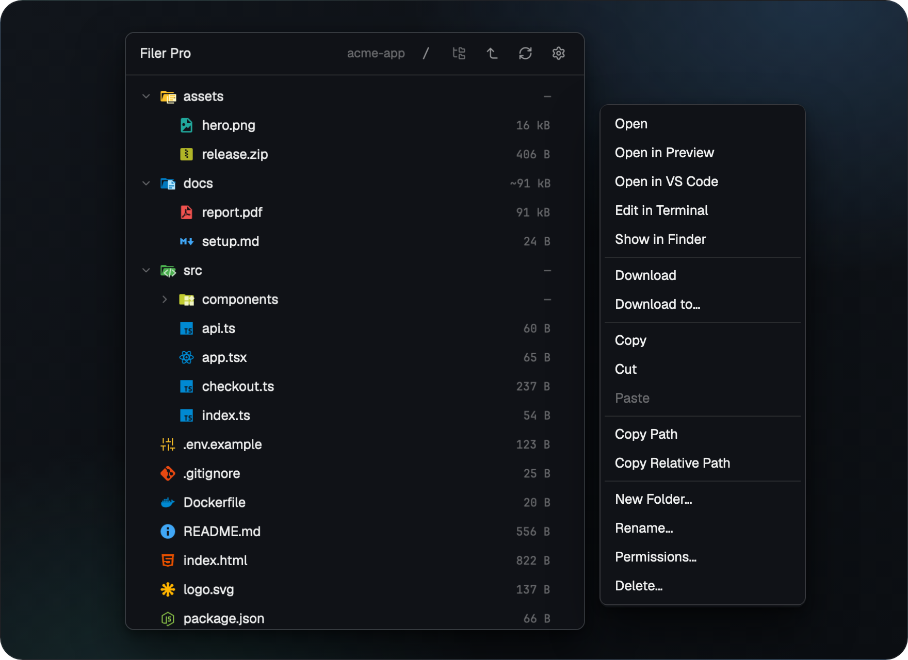
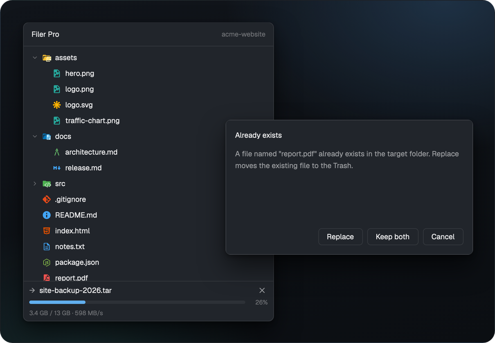
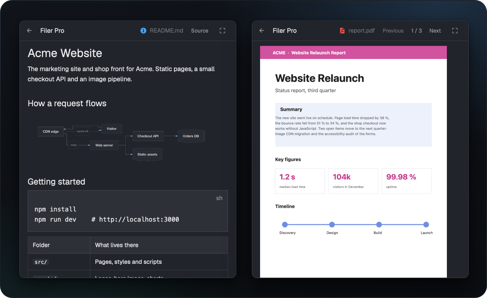
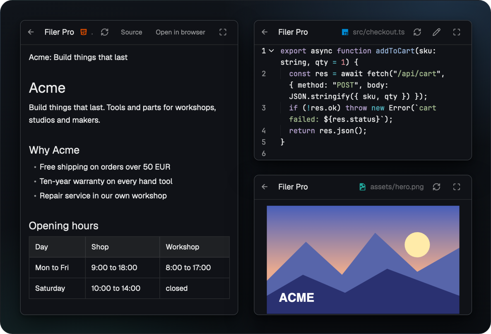

# Filer Pro


**A file panel for the [Herdr app](https://herdr.dev) that works the same on your Mac and on every machine you reach over SSH.**

<br>

<p align="center"><a href="https://www.buymeacoffee.com/michaelmayer"></a></p>

<br>

## Install

In Herdr, ask your agent:

```text
Read ~/.config/herdr-app/AGENTS.md, then add this mod: https://github.com/Srv-02/herdr-filerpro/tree/main
```

Then click `Filer Pro` in the tab bar. To install by hand, see [Manual install](#manual-install).

## Features

### Follows your terminal



The tree shows the folder of the focused terminal, locally or on its machine. Right click for open, download, copy, paste, rename and delete.

### Transfers you can trust



Drop files from the Finder to upload, right click to download. Every transfer shows progress and can be cancelled, and nothing is overwritten without asking.

### Preview



Markdown renders with Mermaid diagrams, PDF shows page by page. Remote content inside documents is never loaded. `←` goes back to the tree where you left it, with the file you just opened marked.

### Source, HTML and images



Code opens with syntax colors and line wrap, HTML and images open in place. One click goes fullscreen.

## Details

### Requirements

- Herdr app with its shipped `tabs` mod.
- macOS as the local side. Remote machines: Linux or macOS, added to Herdr as SSH machines with key based login.
- Optional: Node.js for Mermaid diagrams, macOS 15 or later for `Delete…` on local files.

### Manual install

1. Copy the mod folder. The folder must be named `filer-pro`.

   ```sh
   cp -R mods/filer-pro ~/.config/herdr-app/mods/filer-pro
   herdr-app check ~/.config/herdr-app/mods/filer-pro
   ```

2. Clone a layout (`herdr-app do layout.clone '{"name":"main","as":"my-layout"}'`) and in `~/.config/herdr-app/layouts/my-layout.json` replace the `tabs` block with:

   ```json
   { "id": "tab-bar", "type": "row", "size": { "px": 42 }, "resizable": false, "children": [
     { "id": "tabs", "type": "block", "content": { "mod": "tabs" }, "window_drag": true },
     { "id": "filer-pro-button", "type": "block", "content": { "mod": "filer-pro", "props": { "button": true } }, "size": { "px": 96 }, "window_drag": true }
   ] }
   ```

   Add the panel as the first child of `panel` > `panel-body`:

   ```json
   { "id": "filer-pro", "type": "block", "content": { "mod": "filer-pro" }, "size": { "weight": 1 }, "min": 120 }
   ```

3. Click `Filer Pro` in the tab bar. No `keys.json` entries are needed.

### Configuration

`~/.config/herdr-app/filer-pro.json`:

```json
{ "download_folder": "~/Downloads", "preview": true, "mermaid": true, "perf": false }
```

`{ "preview": false }` turns the preview off (source view only), `{ "mermaid": false }` leaves Mermaid fences as code. `{ "perf": true }` writes render timings to `~/.config/herdr-app/data/filer-pro/perf.jsonl`.

To remove only the preview, delete `mods/filer-pro/preview/` from the installed mod. Files then open as source. The caches `data/filer-pro/diagrams/`, `data/filer-pro/images/` and `data/filer-pro/loads/` under `~/.config/herdr-app/` can go too.

### What it runs and touches

- **Programs:** `ssh` and `scp`, `hc`, `sh`, `cp`, `mv`, `git status` (read only), `open`, `xattr`, `pbcopy`, `/usr/bin/trash`, `osascript` (PDF pages through PDFKit) and `node` (Mermaid).
- **Files:** it lists and changes files wherever you browse and act, locally and on your machines. Its own data lives in `~/.config/herdr-app/filer-pro.json`, `~/.config/herdr-app/data/filer-pro/` and `~/.config/herdr-app/filer-pro/`.
- **Automation folder:** the mod watches `~/.config/herdr-app/filer-pro/requests/` for JSON requests (download, upload, copy, rename, delete and more). Anything that can write to that folder can drive the mod.
- **Network:** only SSH to the machines you added to Herdr. Documents never load remote content.

### Removing

1. Remove `filer-pro` from `workspace.panels` in `~/.config/herdr-app/shared.json`.
2. Remove the two blocks from your layout.
3. Delete `~/.config/herdr-app/mods/filer-pro` and `~/.config/herdr-app/data/filer-pro`, optionally also `~/.config/herdr-app/filer-pro.json` and `~/.config/herdr-app/filer-pro/`.

### Development

```sh
npm test        # unit and integration tests (Node, no Herdr needed)
npm run lint    # syntax check of all scripts
```

Local side is macOS, remote side Linux or macOS. Platform specific code lives in `mods/filer-pro/lib/platform.js` and `mods/filer-pro/bin/transfer.sh`. [RECIPE.md](RECIPE.md) describes the mod as a brief to build it from scratch.

## Credits

Built on the Files mod of [Herdr](https://github.com/herdrdev/herdr-app) (Apache-2.0). Icons from [file-icons](https://github.com/cybertron288/herdr-mods) by cybertron288 and the [Material Icon Theme](https://github.com/material-extensions/vscode-material-icon-theme) (MIT). Preview and Mermaid from [herdr-files-plus](https://github.com/jjongkwann/herdr-files-plus) by jjongkwann (MIT), with [beautiful-mermaid](https://github.com/lukilabs/beautiful-mermaid) (MIT), [elkjs](https://github.com/kieler/elkjs) (EPL-2.0) and [entities](https://github.com/fb55/entities) (BSD-2-Clause). Menu entries inspired by [herdr-files-open-with](https://github.com/tomislavpet/herdr-files-open-with) by tomislavpet. Details in `THIRD_PARTY_NOTICES.md`.

## License

MIT, see [LICENSE](LICENSE). Third party parts keep their own licenses.
