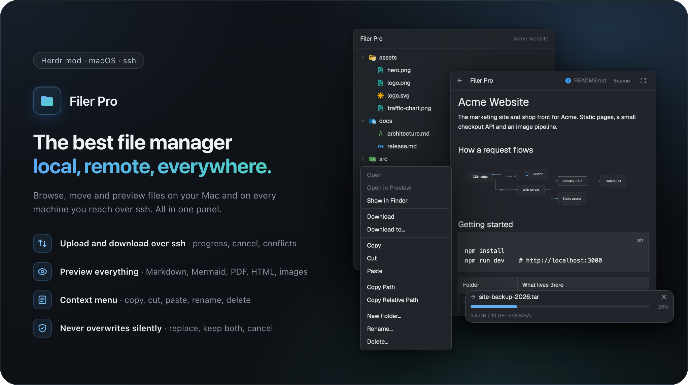
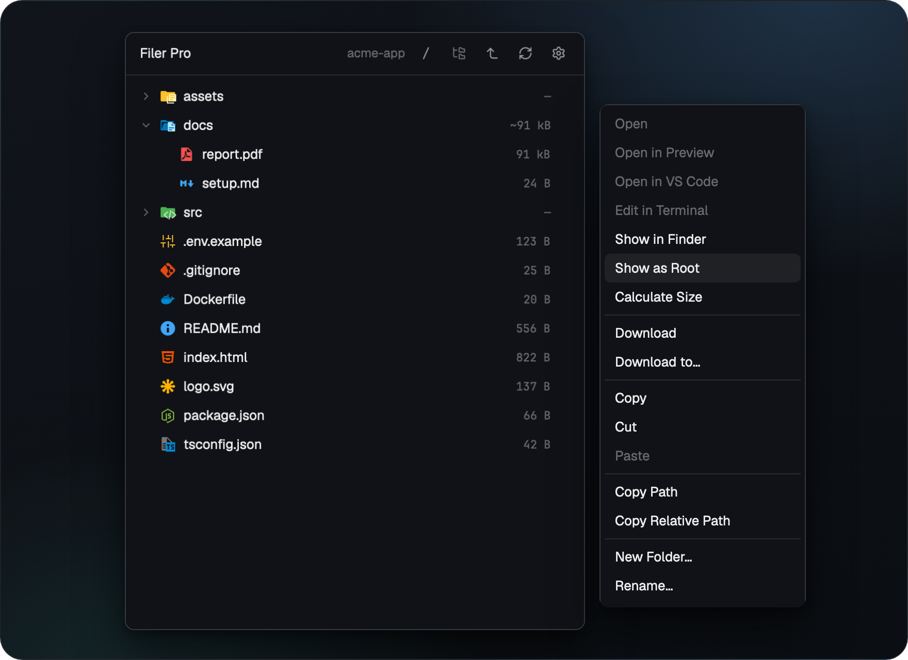
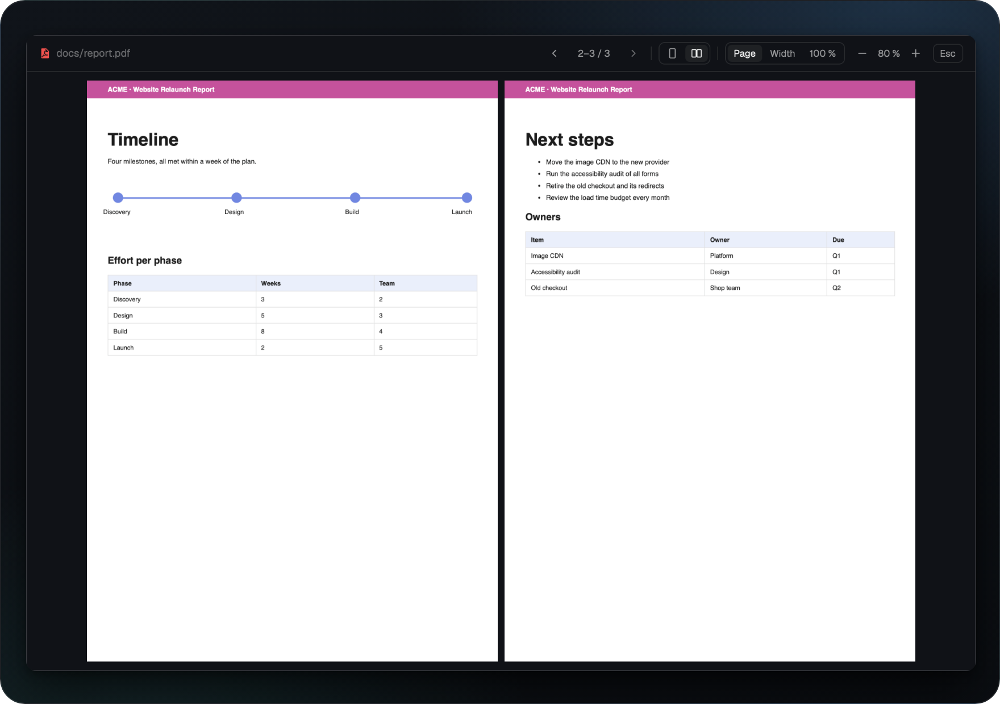
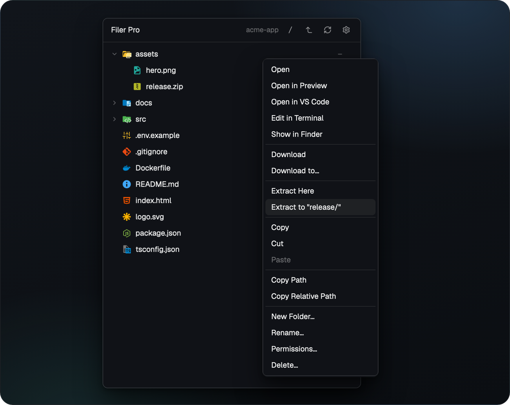

# Filer Pro



**A file panel for the [Herdr app](https://herdr.dev) that works the same on your Mac and on every machine you reach over SSH.**

- **Follows your terminal:** the tree shows the folder of the focused terminal, local or remote.
- **Previews almost anything:** Markdown with Mermaid diagrams, PDF, code, HTML and images, also in full screen.
- **Edits in place:** quick fixes right in the panel, or one click to your editor.
- **Moves files between machines:** upload, download and copy from one SSH machine to another.
- **Quiet on SSH machines:** no commands sent while you just look.

<br>

<p align="center"><a href="https://www.buymeacoffee.com/michaelmayer"></a></p>

<br>

## Install

In Herdr, ask your agent:

```text
Read ~/.config/herdr-app/AGENTS.md, then add this mod: https://github.com/Srv-02/herdr-filerpro/tree/main
```

Then click `Filer Pro` in the tab bar.

- **Needs** Herdr on macOS. SSH machines can run Linux or macOS.
- **Update:** the header shows `● <version> available` when a new release is out; install it the same way.
- **By hand, removing, requirements:** see the [guide](docs/GUIDE.md#install).

## Features

### Browse

- **Your terminal's folder:** `cd` in the terminal, and the tree follows.
- **Navigate freely:** Up one level, Go to `/`, and one click back to the terminal's folder.
- **Sizes and git marks:** file sizes next to each name, Calculate Size for folders, `M` `A` `U` `D` from git.
- **Always current:** follows file system events on this Mac, no polling.


### Show as Root

- **Focus on one folder:** pick **Show as Root** in its row menu, or double-click it.
- **One click back:** Up one level or Back to the terminal's folder.



### Preview

- **Markdown** with Mermaid diagrams.
- **PDF** page by page, in full screen also as a two page spread, zoom 50–300 %.
- **Safe:** remote content inside documents is never loaded.




### Code, HTML and images

- **Code** with syntax colors and line wrap.
- **HTML and images** in place, one click to full screen.
- **Clear reasons** when a file can't be shown: binary, too large, no permission.


### Edit

- **Right in the panel:** small edits in the source view, locally and on your machines.
- **Undo, Redo, Save, Save a Copy…**, with `●` for unsaved changes.
- **Safe saves:** a save is refused if the file changed meanwhile; permissions, owner and line endings stay.

### Editors

- **Open in VS Code, Cursor or Zed**, also for files on SSH machines.
- **Edit in Terminal** with vi, nano or helix, in a split next to your terminal.
- **Bring your own:** add more editors in the config file ([how](docs/GUIDE.md#editors)).


### Transfers

- **Drop to upload** from the Finder, right click to download.
- **Progress and cancel** for every transfer, nothing overwritten without asking.
- **Machine to machine:** Copy on one, Paste on the other, through this computer.


### Archives

- **Extract Here** or **Extract to "name/"** from the row menu, locally and on machines.
- **zip, tar and compressed tars** (gz, bz2, xz, zst), and single compressed files.
- **Safe:** the archive is never changed; absolute paths and `..` are refused before anything is written.



### Permissions

- **Matrix and octal:** Owner / Group / Others by Read / Write / Execute, in sync with the octal field.
- **Warnings while you edit:** world writable, losing your own access, special bits, changes inside a folder.
- **Only your own entries:** no `sudo`, no `chown`, links never changed.

### Settings

- **One dialog:** the gear in the panel header, changes apply without a restart.
- **Your way:** one click or two for files and apps, and what the tree hides.
- **Update check:** once a day, one switch turns it off.


Every key, default and limit: [Settings in the guide](docs/GUIDE.md#settings).

## Documentation

- **[Guide](docs/GUIDE.md):** every feature, setting and limit in detail.
- **[What it runs and touches](docs/GUIDE.md#what-it-runs-and-touches):** programs, files and network access.
- **[RECIPE.md](RECIPE.md):** the mod as a brief to build it from scratch.
- **[Development](docs/GUIDE.md#development):** tests, lint and benchmarks.

## Credits

- Built on the Files mod of [Herdr](https://github.com/herdrdev/herdr-app) (Apache-2.0).
- Icons from [file-icons](https://github.com/cybertron288/herdr-mods) by cybertron288 and the [Material Icon Theme](https://github.com/material-extensions/vscode-material-icon-theme) (MIT).
- Preview and Mermaid from [herdr-files-plus](https://github.com/jjongkwann/herdr-files-plus) by jjongkwann (MIT), with [beautiful-mermaid](https://github.com/lukilabs/beautiful-mermaid) (MIT), [elkjs](https://github.com/kieler/elkjs) (EPL-2.0) and [entities](https://github.com/fb55/entities) (BSD-2-Clause).
- Menu entries inspired by [herdr-files-open-with](https://github.com/tomislavpet/herdr-files-open-with) by tomislavpet.

Details in [THIRD_PARTY_NOTICES.md](THIRD_PARTY_NOTICES.md).

## License

MIT, see [LICENSE](LICENSE). Third party parts keep their own licenses.
