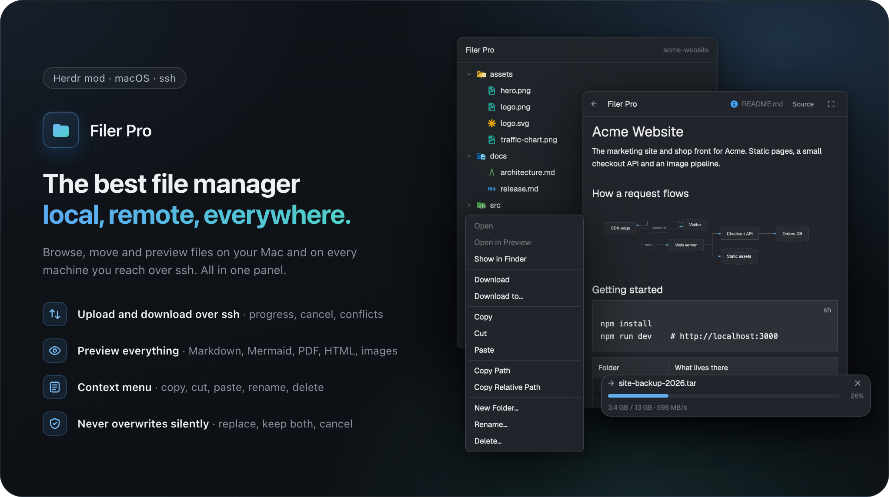

# Filer Pro

A file panel in the right panel column, opened from a `Filer Pro` pill at the right end of the tab bar. It shows the working folder of the focused terminal as a tree, on this Mac or on the SSH machine the terminal runs on. A right click on a row opens a menu to open, download, copy, cut, paste, rename, delete or create folders; Cmd+click downloads and reveals; files dropped from the Finder are uploaded. Transfers show as rows with a progress bar below the tree. Clicking a file opens it in the panel as source, as a Markdown or HTML preview with Mermaid diagrams, as an image or as PDF pages, with a fullscreen dialog.

## What you see

All colors are `theme()` tokens, so the mod follows the person's theme.

**Tab bar pill** (block `filer-pro-button`, 96px wide, at the right of a 42px row `tab-bar` beside the `tabs` block). Fills the block, `bg(t.chrome)`, `border_b(1)` in `t.border`, content right-aligned with `pr(10)`. The pill: 26px high, `px(8)`, gap 5, radius 6, text 12; a 14px `folder.svg` (tinted) and the label `Filer Pro`. When the panel shows Filer Pro: `bg(t.selected)`, text `t.foreground`; else `bg(t.chrome)`, text `t.muted`; hover `bg(t.hover)`.

**Panel** (block `filer-pro`, first child of `panel` > `panel-body`), top to bottom:

1. **Header**, 42px, `px(14)`, gap 8, `border_b(1)` `t.border`. Left: `←` (20px wide, `t.muted`, only while a file is open), then `Filer Pro` in semibold. Right-aligned: a 14px file type icon and the open file's relative path (or the shown folder's name), text 12, `t.dim`, truncated. Then the header buttons for an open file: `Source` / `Preview` (names the view you switch to), `Open in browser` (local HTML only), `Previous`, `3 / 12`, `Next` (PDF), and the fullscreen button (13px `maximize.svg`). Each button: `px(7)`, `py(2)`, radius 6, text 11, `t.muted`, hover `bg(t.hover)`.
2. **Tree** (no file open), scrolls, `p(6)`. Rows 28px, radius 7, hover `bg(t.hover)`, left padding `8 + depth * 18`px, gap 7: a 12px chevron (`chevron-right.svg` / `chevron-down.svg`, `t.dim`) for folders or a 12px spacer, a 16px full-color file type icon (Material Icon Theme, light or dark variant from `settings().dark`, open-folder variant when expanded), the name (truncated), and on the right a git mark in text 11: `A` (`t.ansi2`), `M` (`t.blocked`), `D` and `U` (`t.ansi1`). Folders sort first, then by name. Empty states in text 12 `t.dim`, `p(8)`: `Loading files…`, `No files`, `No folder`, or the error. Over 500 entries in a folder or 5,000 in total: `File list limited to 500 entries per folder and 5,000 total` (text 11).
3. **Viewer** (file open, instead of the tree): a read-only editor with syntax colors and soft wrap, a Markdown or HTML text view, an image, or a PDF page. Notes like `Loading file…`, `Loading image…`, `Loading PDF…` in `t.dim`, `p(12)`.
4. **Transfers bar**, only while jobs exist. `border_t(1)` `t.border`, height = sum of rows + 1, at most 220px, then it scrolls. Each row `px(10)`, `py(6)`, gap 3, oldest first:
   - name line 20px: direction glyph in a 12px column (`↓` down, `↑` up, `→` local or remote copy, `t.muted`), the name (truncated), `✕` in a 20px column (`t.muted`, hover `t.foreground`);
   - track line 16px: a 6px track, radius 3, `bg(t.hover)`, fill `t.ansi4` (`t.ansi1` for failed), percent at the right in a 34px column (text 11, `t.dim`);
   - detail line 16px, text 11, `t.dim`: `1.2 MB / 8.0 MB · 3.4 MB/s` while running, the total when done, `Cancelled`;
   - a failed row adds its full error text in `t.ansi1`, text 11, wrapping.

The panel root: `rounded(10)`, `border_1()` `t.border`, `bg(t.background)`, text 13, `t.foreground`.

**Overlays** (all are copies of this mod with props `{ view: ... }`):

- **Menu**: popup at the pointer, 200px wide, height = 28 per entry + 7 per separator + 12. `p(4)`, `bg(t.background)`, text 13. Entries 28px, `px(10)`, radius 6, hover `bg(t.hover)`; unusable ones `t.dim` without hover. Row menu: `Open`, `Open in Preview`, `Show in Finder` | `Download`, `Download to…` | `Copy`, `Cut`, `Paste` | `Copy Path`, `Copy Relative Path` | `New Folder…`, `Rename…`, `Delete…` (separators: 1px `t.border`, `my(3)`). Free area menu: `New Folder…`, `Paste`.
- **Question dialog**: modal, 440 × 240, `p(16)`, gap 12, `bg(t.background)`, text 13. Semibold title (`Already exists`, `Symlink found!`, `Could not check symlinks`, `Delete file?`, `Delete folder?`, `Another volume`), body in `t.muted`, for delete the path in text 11 `t.dim`, `☐ Apply to all (N)` when more than one item waits, buttons right-aligned: 30px, `px(14)`, radius 6, `border_1()` `t.border`, hover `bg(t.hover)`. The final remote `Delete` is `t.ansi1`.
- **Name dialog** (`Rename`, `New Folder`): modal, 440 × 220, `p(18)`, gap 10, `bg(t.popover)`. Title 15 semibold with `Esc` (11, `t.dim`) at the right; a 32px input, radius 8, border `t.accent` when focused else `t.input`; a 16px error line in `t.ansi1`; buttons 32px, radius 8: `Cancel` (`bg(t.raised)`), primary (`Rename` / `Create`) `bg(t.solid)` with `t.solid_foreground`, dim and inert when the name is invalid or unchanged.
- **Fullscreen**: dialog at 0.86 × 0.9 of the window, a 42px header with icon, path, the same buttons and `✕`, then the same viewer.

## How it behaves

The mod shows no agent status (working, blocked, done, idle); it follows only the focused terminal.

- **Location:** the tree shows `cwd` of the focused pane (else the space folder) and runs every listing on that terminal's machine (`exec(..., { on })`). A change of focus switches the tree; open folders and the open file are kept per location and restored. The tree refreshes on `watchFolder(root)`, every 10s, and after any action (shared `filer-pro.changed`: first signal at once, then at most once per second, never during a load).
- **Rows:** click a folder to expand or collapse, a file to open it in the viewer. Cmd+click: remote rows download into the download folder and reveal in the Finder; local rows only reveal (`open -R`). Right click opens the menu. Dropping Finder items: onto a folder row into that folder, onto a file row into its folder, onto the free area into the shown folder; a remote tree uploads, a local tree copies.
- **Pill:** toggles the panel. With `panel-body` as a stack it selects `filer-pro` and shows `panel` (or hides `panel` when already on); as a column it shows or hides the `filer-pro` child. Without `panel` or `panel-body`, a toast: `Add the filer-pro block to panel-body`.
- **Menu entries:** `Open` / `Open in Preview` use `open` / `open -a Preview` after a check that the resolved path is a regular file; remote files download first and get the quarantine flag (`xattr -w com.apple.quarantine`) before opening. `Show in Finder` is dim on a machine; `Open` and `Open in Preview` are dim for folders. `Download to…` asks with `pickFolder`. `Copy` / `Cut` remember one item in shared `filer-pro.clipboard`; `Paste` is dim without one, for an impossible target, across two different machines, and for a cut into its own folder. `Copy Path` / `Copy Relative Path` write a shell-safe path (`cx.write_to_clipboard`, fallback `pbcopy`).
- **Transfers:** each job runs `bin/transfer.sh` in a hidden `hc` terminal (`hc run --bg --no-parent --no-notify`). Down and up use `scp` with `BatchMode=yes`; local copies and copies within one machine use `cp -R -P -p`. Progress comes from the growing temp file's size against a measured total (unknown total: the fill pulses, opacity 0.25 to 1 every 1200ms). `✕` on a running row cancels and removes the temp item; on a finished row hides it. Done and cancelled rows leave after 10s; failed rows stay. Toasts: `Downloaded` (with action `filer-pro.reveal`), `Copied`, `Uploaded`, errors as `Download failed`, `Upload failed`, `Copy failed`, ...
- **Conflicts:** an existing target opens the question dialog: file `Replace` / `Keep both` / `Cancel`, folder also `Merge`; a move has no `Merge`. The body says what happens (`Replace moves the existing folder to the Trash.` locally, `Replace deletes the existing folder on <machine> permanently.` remotely). `Keep both` takes the first free `name-1.ext`, comparing names case and Unicode insensitively. Esc counts as `Cancel`; no answer within 5 minutes counts as `Cancel`.
- **Rename / New Folder:** the dialog runs the change itself; a refusal shows in its red line and the dialog stays open with the typed text. Success closes it with a toast (`Renamed`, `Folder created`).
- **Delete:** always asks. Local: `Move to Trash` via `/usr/bin/trash` (macOS 15+). Remote: `Delete` in red, `rm -r -f` for good. Home, the shown folder, folders above them, system folders and entries directly below `/` are refused, checked physically (`cd -P`, `-ef`) in one shell script.
- **Viewer:** Markdown and HTML open as preview, everything else as source. Images over 20MB and PDFs over 100MB local / 20MB remote show `File is larger than … MB` with a **Load** button that fetches the file through a transfer job into `data/filer-pro/loads/`. Document images, scripts and frames are stripped; links open on click only for `http(s)`. Mermaid fences render as SVG in a Node child process.

## Built from

Folder `mods/filer-pro/`, `mod.json` `{ "place": "none" }` (no `focusable`). No `keys.json`.

- **One `View`, four roles by props:** no props: the panel; `{ button: true }`: the pill (it also adds `filer-pro` to shared `workspace.panels` with `setShared`, so the shipped `tabs` mod restores the panel per space, then only listens for `reveal`); `{ overlay, view: "menu" | "conflict" | "rename" | "mkdir" | "file" }`: the overlays, opened with `openOverlay({ mod: "filer-pro", ... })`.
- **Layout blocks it needs** (the person's own layout; shipped layouts are cloned first): in a row `tab-bar` (42px): `{ "id": "filer-pro-button", "type": "block", "content": { "mod": "filer-pro", "props": { "button": true } }, "size": { "px": 96 }, "window_drag": true }`; in `panel` > `panel-body`, first: `{ "id": "filer-pro", "type": "block", "content": { "mod": "filer-pro" }, "size": { "weight": 1 }, "min": 120 }`.
- **Shipped mods:** a clone of `files` (`cloned_from` `files` 0.1.12) as the base of the tree; `tabs` for the per-space panel memory.
- **Clicks become request files.** UI actions write `ui-<id>.json` into `appHome()/filer-pro/requests/`; one copy holds a lease (shared `filer-pro.lease`, renewed every 5s, taken over after 15s) and processes requests (`watchFolder` on that folder, command `filer-pro.scan`), writes `<id>.result.json`, runs the jobs (`filer-pro.jobs`, ticked every 1s) and shows dialogs (`filer-pro.pending` / `filer-pro.answer`). The same JSON drives the mod from outside.
- **`herdr` functions:** `spaces`, `panes`, `focused`, `exec` (with `on`), `hc` (`run`, `get`, `kill`, `rm`, `machine ls --json` for the SSH target), `readTextFile`, `writeTextFile`, `watchFolder`, `theme`, `settings`, `window`, `shared`, `setShared`, `notify`, `props`, `appHome`, `home`, `nextCommand` (`scan`, `reveal`), `openOverlay`, `closeOverlay`, `pickFolder`, `layout`, and `run` for `layout.select`, `layout.show`, `layout.hide`.
- **Files:** `main.js`; `ui/` (`bar.js`, `menu.js`, `conflict.js`, `namedialog.js`); `lib/` (pure logic: jobs, requests, file operations and their shell scripts, names, sizes, clipboard, lease, panels, config, platform); `preview/` (loaded only by `import()`, the removable preview: `index.js`, `prepare.js`, `strip.js`, `images.js`, `pdf.js`, `mermaid.js`, `diagrams.js`, `mermaid.bundle.js`); `bin/transfer.sh` (POSIX sh); `bin/render-mermaid.mjs` (Node).
- **Programs:** `sh`, `ssh`, `scp`, `cp`, `mv`, `git status --porcelain=v1 -z`, `open`, `xattr`, `pbcopy`, `/usr/bin/trash`, `osascript -l JavaScript` (PDFKit, pages up to 2048px), `node` (from the login shell, `/opt/homebrew/bin/node` or `/usr/local/bin/node`).
- **Art:** `folder.svg`, `file.svg`, `chevron-right.svg`, `chevron-down.svg`, `maximize.svg` (Lucide), `icons/` with 1,184 Material Icon Theme SVGs mapped by `icons.js` and `lib/icons.js`.
- **Config:** `appHome()/filer-pro.json` with `download_folder` (default `~/Downloads`), `preview`, `mermaid`, `perf`.
- **Data:** `data/filer-pro/images/` (50MB cache), `data/filer-pro/loads/`, `data/filer-pro/diagrams/`, `data/filer-pro/perf.jsonl`.

## Watch out

- The folder name is load-bearing: `lib/icons.js` has `BASE = "mods/filer-pro"`, and `lib/jobs.js` starts `appHome()/mods/filer-pro/bin/transfer.sh`. A renamed copy must change both, the block ids, the `mod` names in the layout and the shared keys `filer-pro.*`.
- `"place": "none"`: nothing appears until both layout blocks exist. The panel copy starts only when the panel first shows; until then requests wait and interrupted jobs are not resumed. `filer-pro.reveal` reaches shown copies only, so the pill copy answers it while the panel is hidden.
- `exec` stops after 30s. Long transfers must run in `hc` terminals, never in `exec`; remote deletes of huge trees can be cut off.
- The mod runtime has no `setTimeout`; use `cx.sleep` and `cx.timer`. It runs on the draw thread and is about six times slower than Node: preview preparation runs in chunks of about 4,000 characters with a pause between.
- Never interpolate paths into shell text: every script gets paths as `"$1"`, `"$2"`. Relative paths get `./` so a leading `-` is never an option.
- `scp` follows symlinks and loops forever on `self -> .`: check folders for outside links and loops before an SSH transfer. `cp -R -P` never follows links.
- Removing a whole tree with `rm -r` on a machine must refuse mounted file systems below the target (read `/proc/self/mountinfo` or `mount`).
- Shared values cannot be deleted, only set to `null`. Editing `shared.json` by hand while Herdr runs is overwritten.
- Limits: 500 entries per folder, 5,000 in the tree; preview 200,000 characters, source 400,000; 20 diagrams per document, 20,000 characters each, 30s render; images 20MB and 100 megapixels; image cache 50MB.
- Assumes macOS as the local side (Finder, Preview.app, Trash, PDFKit) and SSH machines from `hc machine ls`; machines connected via a command are refused.

## Done when

- `herdr-app check ~/.config/herdr-app/mods/filer-pro` passes.
- With both blocks in the layout, the `Filer Pro` pill shows in the tab bar and a click opens the panel; a second click hides it. `workspace.panels` now contains `filer-pro`.
- The tree shows the focused terminal's folder; focusing a terminal on an SSH machine shows that machine's folder.
- In a git repo, an untracked file shows a green `A`.
- Right click on a remote file, `Download`: a `↓` row runs to 100 %, a `Downloaded` toast appears, the file is in the download folder. Downloading it again opens `Already exists`; `Keep both` creates `name-1.ext`.
- Dropping a Finder file onto a remote folder row uploads it there (`↑`, `Uploaded`).
- `✕` on a running transfer ends it as `Cancelled` and leaves no temp file.
- `Rename…` to an existing name shows `"<name>" already exists` in the dialog and keeps it open.
- `Delete…` on a local file moves it to the Trash; on a machine the button is a red `Delete`.
- Clicking a `.md` file with a Mermaid fence shows the rendered diagram; `Source` shows the text; the fullscreen button opens it at 86 % × 90 %.
- Deleting `mods/filer-pro/preview/` leaves files opening as source without errors.
