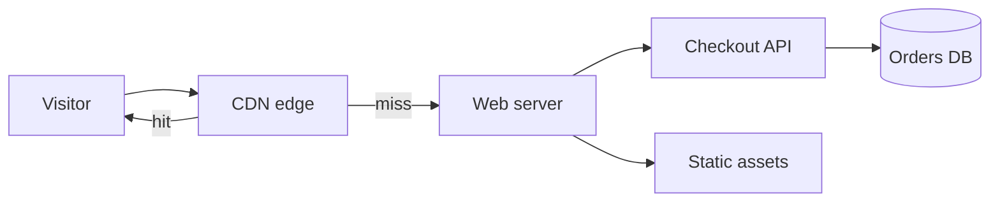

# Acme App

The customer portal for Acme. A small checkout API, static pages and an image pipeline.

## How a request flows



## Getting started

```sh
npm install
npm run dev    # http://localhost:3000
```

| Folder | What lives there |
| --- | --- |
| `src/` | Pages, styles and scripts |
| `assets/` | Logos, hero image, charts |
| `docs/` | Setup notes and the quarterly report |
